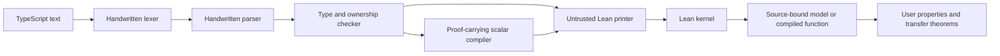

# Architecture and development

`Source` owns spans and diagnostics. `Syntax` defines types and source ASTs. `Lexer`
and `Parser` are total, resource-bounded Lean functions. Numeric decoding and type
equality use explicit structural computations so certificate checking does not
depend on opaque native implementation helpers.

`Check` resolves aliases, checks types/returns, identifies reference roots, rejects
new aliases and escaping borrows, and protects traversal receivers. Reference
parameters are exclusive borrows and reference results are owned. This first analysis
is intentionally conservative; it is not a Rust borrow checker or a proved soundness
result. More precise regions and function effects should extend the analysis later.

`Value` contains scalar operations and an explicit heap. Variables are heap cells,
so callbacks observe writes to captured locals. Collections occupy heap locations.
`Semantics` specifies evaluation order, allocation, lexical scope, calls, completion
kinds, and fuel. Its `runState` exposes the final heap, and `run` exposes only the
returned value. `runState` starts with an empty heap, so its direct argument API is
appropriate for scalar inputs; reference-input examples allocate their inputs in a
TypeScript entry function. A public validated external-heap API is future work.

`Certificate` links exact source to the checked AST. `Emit` prints source, tokens,
ASTs, replay theorems, and fuel-indexed wrappers. Character encoding, lexer, parser, and checker equations
are separate declarations. The kernel checks `String.ofList characters = source`;
Lean’s proved inverse then identifies `source.toList`. This avoids expensive kernel
reduction of UTF-8 decoding without trusting a native decoder. `Kernel` supplies the small
kernel-checked reflexivity tactic. `Properties`, `Hoare`, and `Collections` provide
state/collection observations and reusable reasoning principles.

`Fuel` proves approximation monotonicity for all eleven mutually recursive
semantic functions, lifts it to arbitrary larger budgets, and proves convergence
and source-return determinism. It preserves non-timeout faults as well as values.

`Target` defines executable expression/command combinators. `Compiler` recursively
constructs these functions together with equality proofs against `Semantics`.
Its loop proof covers every runtime budget. `Emit.emitCompiled` prints a selected
entry point plus an equation checking the printed code against the compiler result.
The target retains cells and dynamic values; it never dispatches on source statements.

`Main` implements check, translate, certify, compile, eval, and explain. `Observe` creates
lossless test observations: number bits, bigint strings, UTF-16 units, explicit
undefined, and insertion-ordered collections. The JavaScript differential harness
normalizes NaN payloads, which cannot be observed by this subset.

## Development workflow

1. Change source semantics/checks and add a focused Lean or native regression.
2. Run `lake build ariadne Tests`.
3. Run `scripts/regenerate.sh` when frontend/emitter/source fixtures change.
4. Build changed generated modules, then proof modules. Prefer serial certificate
   builds to avoid excessive memory use.
5. Commit generated changes and run `scripts/check.sh` for the complete review gate.

A feature is not complete merely because a parser accepts it. Its model, receiver
and alias restrictions, error behavior, tests, and proof coverage must be explicit.
Tests must include rejected cases. Keep handwritten proofs outside generated files.
Do not use `sorry`, new axioms, or native decision procedures in the proof chain.

There are no package dependencies. CI installs the pinned Lean toolchain and Bun
as tools. Native tests also run on Node 24+ without transpiler packages. Generated
artifacts include source text directly, so review can check which program a theorem
actually describes. The axiom audit traverses project theorems transitively.

CI runs the same `scripts/check.sh` gates in four phases. `prepare` builds the
library and checks regeneration; `operational`, `shallow-data` and `shallow-values`
build certificates serially on separate runners. The shallow groups partition
all fixtures, with new files included automatically. `verify` restores all checked modules,
builds the user proofs, audits axioms and runs every native regression. The final
job fails if any certificate job fails. Local `scripts/check.sh` runs all four
phases in sequence.

Regeneration uses `extract --no-check` to write candidates for the subsequent
serial kernel builds. Normal `extract` still checks its output before replacing
an existing file. The CLI regression covers both paths. Source-transfer tamper
tests use small, regenerated fixtures in `Examples/Tamper`; the complete shallow
artifacts remain in the build, theorem-coverage checks and axiom audit.
