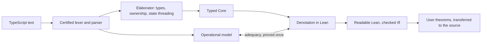

# Certified shallow translation

Status: proposal. This document gives the design and plan for the next version
of Ariadne. It is meant to be reviewed before any of it is built.

## Summary

Today Ariadne gives a TypeScript program its meaning through an operational
model: an interpreter over dynamic values, with an explicit heap, variable cells
and fuel. Every theorem a user proves about a program is a theorem about that
interpreter. This is sound and stays close to the source text, but each proof
pays the same costs again: it unfolds evaluation, tracks allocation addresses,
shows that a cell holds a value with the right tag, and picks enough fuel.

This proposal makes Ariadne emit **shallow** Lean instead. The output is ordinary
definitions over native Lean types (`Int`, `Bool`, `List`, structures, inductive
types, finite maps), with no interpreter, heap, cells or fuel. Ariadne still
certifies that these definitions mean what the TypeScript means. Three pieces
make this possible:

1. **Typed Core.** A small, typed, pure language that checked TypeScript
   elaborates into.
2. **Denotation.** Core's meaning in Lean, written once as a Lean function. The
   shallow translation of a program *is* its denotation, after reduction. The
   kernel checks each emitted definition equal to it (`rfl`), so the printer
   stays untrusted.
3. **Adequacy.** One theorem, proved once for the language: for every program
   that passes the type and ownership checker, the operational model and the
   denotation agree. Per-program transfer theorems follow from it. A property
   proved of the shallow definitions then holds of the source.

The ownership discipline that Ariadne already enforces is what makes this
possible. If no mutable value has two names, a mutation can only be seen through
its owner. So arrays, Maps and objects can be modeled as immutable values, and
the translation threads them through the code.

## Goals

- **Proofs should read like proofs about hand-written Lean.**
  - They use `simp`, `induction`, `cases`, `omega` and `grind` over native types,
    plus a library of lemmas about the JavaScript built-ins that the dialect
    uses.
  - For code in the total fragment, a proof never mentions heaps, cells,
    dynamic value tags or fuel.
- **Accept the TypeScript that real code is written in.** This includes:
  - interfaces and object types with optional and `readonly` fields;
  - string-literal unions, and tagged unions with `switch`;
  - classes with private Map fields, `Map` and `Set`;
  - `for…of`, spread, template literals and `== null` narrowing;
  - the common array and string methods.
- **Keep everything proved or checked, with an explicit trusted base that
  shrinks.** Once adequacy is proved, the elaborator, the denotation and the
  printer are all outside the trusted base.
- **Stay dependency-free and certifying.** Generated files embed the source, and
  the kernel checks every link from the source text to the emitted definitions.

## Non-goals

- **Full TypeScript, or TypeScript's type checker.** The dialect stays a subset:
  the largest one we can give value semantics.
- **Proving the JavaScript engine, TypeScript erasure or the host realm
  correct.** The [runtime contract](RUNTIME.md) stays an explicit assumption.
- **Faster execution.** The TypeScript program is what runs. Lean code is for
  proofs and tests.
- **Replacing the operational model.** It stays the reference meaning of the
  dialect, and the denotation is proved to agree with it.

## Why change the approach

| | Operational (`certify`) | Scalar compiler (`compile`) | Shallow (`extract`, proposed) |
| --- | --- | --- | --- |
| Meaning of a program | The interpreter | The interpreter; compiled code is proved equal to it | The denotation, proved equal to the interpreter |
| What proofs manipulate | `Value`, heap, cells, fuel | `Value`, cells, fuel | Native Lean types |
| Who pays for correctness | Every proof | The compiler, once | The adequacy theorem, once |
| Accepted code | The whole dialect | The scalar fragment | The typed, owned, total dialect |

When proofs go through an interpreter, every proof repeats the same bookkeeping,
and none of it is about the program's logic. A shallow embedding removes that
bookkeeping. But if the shallow translator were merely trusted, a bug in it would
silently change what every theorem says. This design keeps the ergonomics of
shallow code and moves the correctness argument into one theorem about the
language.

The current roadmap's next items are typed state tuples, ownership soundness,
collection compilation and verification-condition generation. This design
delivers each of them in a different form:

- **Typed state tuples:** state threading in Core replaces cells.
- **Ownership soundness:** it is part of the adequacy proof.
- **Collection compilation:** Core has collections.
- **Verification-condition generation:** it becomes ordinary Lean proof over
  shallow code.

The independent grammar and an ECMAScript semantics bridge remain separate work.

## Architecture



For each file, the kernel checks the chain source → tokens → AST → Core →
emitted definitions. It uses the same `kernel_rfl` equations as today, plus two
new links:

- `elaborated : elaborate program = .ok core` says that the elaborator ran on
  this AST and produced this Core program.
- `f_denotes : f = Denote.function interp core i`, for each emitted function `f`,
  says that the readable definition equals the denotation of its Core.

The denotation is an interpreter: a total Lean function over typed Core. When it
is applied to a concrete program and reduced, no Core syntax remains, only a Lean
term. This is the first Futamura projection. The emitter prints that term with
names, `match` and structure syntax, and the kernel checks that the printed text
is definitionally equal to it. So the printer's readability choices can change
freely without any risk to soundness.

Each function is checked against the *emitted* definitions of the functions it
calls, not against their denotations. The checks are earlier in the file and can
be substituted by congruence. The total checking work therefore grows with the
size of the program, not with the depth of its call graph.

### Trusted base

| Component | Today | After this refactor |
| --- | --- | --- |
| Lean kernel, `propext`, `Quot.sound`, `Classical.choice` | Trusted | Trusted |
| Operational model (`Value`, `Semantics`) | The meaning of the dialect | Unchanged: the meaning of the dialect, tested against JavaScript engines |
| Grammar (lexer, parser) | Trusted to match TypeScript on accepted input | Unchanged; tests also cross-parse with the TypeScript compiler |
| Checker and elaborator | A per-file acceptance equation; soundness not proved | Covered by adequacy: an elaboration that changes the meaning cannot be proved adequate |
| Denotation | — | Covered by adequacy |
| Printer | Untrusted: kernel-checked | Untrusted: checked `rfl` |
| Host runtime contract | An assumption | An assumption |

Until the adequacy milestone lands, the denotation is the meaning of extracted
code, and [TRUST.md](TRUST.md) must say so. The plan keeps that period short and
makes it visible.

## Typed Core

Core is a small, pure, intrinsically typed functional language. A term
`Core.Term Γ τ` is well typed by construction. Its denotation
`⟦t⟧ : ⟦Γ⟧ → ⟦τ⟧` is therefore a total structural recursion with no error cases.

**Types:**

- `bool`, `int53`, `number` (binary64), `bigint`, `string` (UTF-16);
- `option τ`, `list τ`, `map κ τ`, `set κ`, products;
- named types, which are the records and unions the program declares.

**Terms:**

- variables, literals, `let` and `if`;
- `match` on options and named unions;
- construction, projection and update of records, and union constructors;
- calls of earlier functions;
- primitive operations, each with a fixed Lean meaning (see
  [Built-ins](#built-ins));
- lambdas passed to primitives.

**Loops:**

- `each xs init body` iterates over a list.
- `range n init body` is a counted loop.
- In tier 1 only, `while measure init body`.

A loop body takes the element and the loop state and returns a `Step`:

- `next s` continues with state `s`;
- `stop s` breaks;
- `ret v` returns `v` from the enclosing function.

```lean
inductive Step (σ τ : Type) where
  | next (state : σ)
  | stop (state : σ)
  | ret (value : τ)

inductive Exit (σ τ : Type) where
  | done (state : σ)
  | ret (value : τ)

def Loop.each (xs : List α) (init : σ) (body : α → σ → Step σ τ) : Exit σ τ :=
  match xs with
  | [] => .done init
  | x :: xs =>
    match body x init with
    | .next s => Loop.each xs s body
    | .stop s => .done s
    | .ret v => .ret v

def Exit.finish (e : Exit σ τ) (rest : σ → τ) : τ :=
  match e with
  | .done s => rest s
  | .ret v => v
```

These combinators live in Ariadne's prelude and do not depend on Lean's `do`
elaborator. Emitted code and the lemma library therefore stay stable across Lean
releases.

### Elaboration

The elaborator turns checked TypeScript into Core. It does the following:

- **State threading.** Mutable locals become shadowed `let`s. For each loop and
  branch, the elaborator computes which outer variables are assigned inside it,
  and threads them through as the loop state or the branch result.
- **Control flow.**
  - A `return` inside a loop becomes `ret`. Inside a block, it becomes an `if`
    whose `else` branch holds the rest of the block.
  - When both branches of an `if` fall through, the rest of the block is bound
    once as a join point (`let k := fun s => …`) rather than duplicated.
  - `break` and `continue` become `stop` and `next`. A `break` inside a `switch`
    leaves only the `switch`.
- **Ownership lowering.** Mutating an owned collection or record becomes
  rebinding:
  - `xs.push(x)` ↦ `let xs := xs ++ [x]`
  - `m.set(k, v)` ↦ `let m := m.set k v`
  - `r.f = v` ↦ `let r := { r with f := v }`

  A function that mutates a borrowed parameter returns the updated value
  alongside its result, and the caller rebinds its argument.
- **Classes.**
  - A class becomes a record type of its fields, plus one Core function per
    method.
  - A method that writes `this` takes the record and returns the updated record
    together with its result. A method that only reads `this` returns just the
    result.
  - `c.m(x)` ↦ `let (r, c) := C.m c x`, and `new C(…)` ↦ `C.new …`.
- **Narrowing.** These become `match`:
  - `switch (u.kind)` and `if (u.kind === 'a')`;
  - `x == null` and `x !== undefined`;
  - `??`.
- **Tiers.** Each function is assigned the lowest [totality tier](#totality-tiers)
  it fits.

Like today's checker, the elaborator is a Lean function that the kernel runs on
each file. It is not trusted: adequacy is a theorem about its output.

### Named types and their interpretation

Readable output needs real Lean declarations such as `structure Entry` or
`inductive Event`. But the denotation is written once, before any program's
types exist. So the denotation takes an **interpretation** of the program's named
types as a parameter. For each declaration, the interpretation gives a Lean type,
its constructors, its projections and its eliminator.

An emitted file contains:

1. the structures and inductive types;
2. an `Interp` value that points at them;
3. a generated proof that the interpretation is lawful: its constructors and
   projections satisfy their β and η laws, checked by `rfl` and `cases`.

The interpretation also supplies the instances (`DecidableEq`, `LT`, …) that the
denotation uses, so printed code and denotation agree on them. Adequacy is proved
for every lawful interpretation, so the per-file part stays a set of definitional
checks.

### Totality tiers

**Tier 0: structural.**

- There is no recursion.
- Loops are one of:
  - `for…of` over an array, a Map or a Set, or over `entries()`;
  - counted loops `for (let i = a; i < n; i++)`, where the loop does not assign
    `n`, and only the loop's update step assigns `i`.
- The denotation is total, and the emitted definitions are plain `def`s.

**Tier 1: well-founded.**

- These are `while` loops and recursion that carry a measure annotation. The
  annotation is a comment, `/** @decreases expr */`, placed immediately before the
  loop or the function, so the TypeScript is unchanged.
- The emitted definition uses `termination_by expr`. Its `decreasing_by`
  obligation is discharged by `omega` or `simp`, or by a lemma in a user file.
- The denotation of a tier-1 function is defined by fuel bounded by the measure.
  The check against it uses one library lemma: a function defined by
  well-founded recursion on a measure equals the fueled iteration of its body,
  at any fuel above the measure.

**Tier 2: fuel.** Everything else the frontend accepts stays on the operational
and scalar-compiler paths, as today. Shallow extraction reports which construct
keeps a function out of tiers 0 and 1.

## Ownership becomes value semantics

Shallow translation models arrays, Maps, Sets, records and class instances as
immutable Lean values. That is correct exactly when no mutation can be seen
through a second name. The checker's ownership rules state this precisely:

1. Every mutable value has one owner. The owner is a local, a parameter, or a
   field of `this`. A parameter is an exclusive borrow for the duration of the
   call.
2. Only the owner mutates. Binding a second name to a mutable value is rejected.
   A later milestone may accept it as a move when the first name is no longer
   used.
3. A value stored into an array, Map, Set or field is one of the following:
   - **Of an immutable type.** This means scalars, strings, unions of
     immutable types, and `readonly` records and arrays whose elements are
     immutable.
   - **Freshly built.** This means a literal, a spread, or the result of a
     built-in that allocates, such as `map`, `filter`, `slice` or `toSorted`.
4. Values read out of a container (with `get`, indexing or iteration) are
   read-only.
5. A function returns owned or immutable values. It never returns a borrowed
   parameter, or a mutable part of one.
6. `this` and its fields do not escape a method. They are not returned, not
   stored, and not captured by a closure that outlives the call.
7. Callbacks passed to built-ins are pure: they do not assign captured variables
   and do not mutate anything. `forEach` is accepted by desugaring it to
   `for…of`.

In the adequacy proof, these rules give the footprint invariant:

- The heap objects reachable from distinct owners are disjoint.
- Shared objects are never written.

The rules are what the proof needs and no more. If a rule turns out to be too
weak, the proof fails; the result is never an unsound theorem.

## Data types

| TypeScript | Lean |
| --- | --- |
| `boolean` | `Bool` |
| `number` | `Float.Model`, the existing binary64 model |
| `Int53` (see [Numbers](#numbers)) | `Int`, with safe-range obligations |
| `bigint` | `Int` |
| `string` | `JSString` (UTF-16 code units) |
| `T \| undefined`, `T \| null`, optional field `f?: T` | `Option ⟦T⟧` |
| `T[]`, `readonly T[]` | `List ⟦T⟧` |
| `[A, B]` | `⟦A⟧ × ⟦B⟧` |
| `Map<K, V>`, `ReadonlyMap<K, V>` | `JSMap ⟦K⟧ ⟦V⟧` |
| `Set<K>`, `ReadonlySet<K>` | `JSSet ⟦K⟧` |
| `interface I { … }`, `type I = { … }` | `structure I` |
| `'a' \| 'b'` | `inductive`, one constructor per literal, with `toJSString` |
| `{ kind: 'a'; … } \| { kind: 'b'; … }` | `inductive`, one constructor per variant, fields as arguments |
| `class C { private … }` | `structure C`, with functions `C.new` and `C.method` |

- **Optional fields.** JavaScript tells a missing field from one that holds
  `undefined` only through `in`, `Object.keys`, `hasOwnProperty`, enumeration
  and JSON. The dialect excludes all of these, so `Option` is adequate.
- **`T | null | undefined`** is accepted only where `null` and `undefined` are
  treated alike (`== null`, `??`). It then becomes `Option`.
- **Strings.** Lean's `String` is not adequate for `string`, for two reasons:
  - JavaScript compares strings by UTF-16 code units, which orders U+FF00 above
    U+10000.
  - JavaScript strings can contain lone surrogates.

  `JSString` keeps code units. Literals print as `js"…"`, a notation whose
  expansion the kernel checks like any other emitted term.
- **Arrays** become `List`, not `Array`. Lists are the better-supported path for
  proofs in Lean, and execution speed is not a goal.
- **Number-keyed Maps and Sets** compare keys with SameValueZero: `NaN` equals
  itself, and `-0` equals `+0`. `JSMap` is generic in a key equality, which the
  prelude instantiates for each key type.

## Numbers

`number` keeps its exact binary64 meaning. Most integer code is not about
floating point, and proofs about it should not have to be either. So the dialect
adds one refinement, `Int53`.

**Declaring it.** A type alias written exactly as `type Int53 = number;` declares
the refinement. Other aliases can name it, as in `type Size = Int53;`. TypeScript
sees `number`; Ariadne sees integers.

**Typing rules.**

- `Int53` values are integers in the safe range, ±(2^53 − 1).
- Integer literals in that range have type `Int53`.
- A local has the type of its annotation or, without one, of its initializer.
  So `let total = 0` is `Int53`. Assigning it a non-integer later is an error,
  and the fix is an annotation: `let total: number = 0`.
- `+`, `-`, `*`, unary `-`, `%` and comparisons stay in `Int53`.
- `/` produces `number`. `Math.floor` and `Math.trunc` of an `Int53` quotient
  produce `Int53` (`Int.fdiv` and `Int.tdiv`).
- `Int53` converts implicitly to `number`, never back.

**Meaning and obligations.**

- The denotation uses unbounded `Int` arithmetic, so emitted code is ordinary
  integer code.
- For each function, the emitter also produces a predicate
  `f.safe : ⟦params⟧ → Prop`. It is the denotation of these conditions:
  - every `Int53` operation stays in the safe range;
  - every `%` has a nonzero divisor;
  - every owned-array write is in bounds;
  - refined results preserve canonical integer zero. Operations producing `-0`
    need an additional guard, since widening a native `Int` zero produces `+0`.
- Adequacy holds under `f.safe`.
- The prelude proves that binary64 arithmetic on safe integers is exact. For
  example, `Float.Model.ofInt (a + b) = Float.Model.ofInt a + Float.Model.ofInt b`
  when all three values are safe.
- `.length`, `.size` and loop counters are `Int53`. Library lemmas state that
  lengths are below 2^32, which discharges `f.safe` for most counters.

## Built-ins

Every built-in has a Lean model in the prelude and a set of lemmas. Where
JavaScript leaves room, it also has an obligation.

| Built-in | Model | Obligation or note |
| --- | --- | --- |
| `xs.length`, `xs[i]` | `List.length`, `xs[i]?` | `xs[i]` has type `T \| undefined`, except when `i` is the counter of a counted loop bounded by `xs.length` and the loop does not mutate `xs` |
| `xs.push(v)`, `xs[i] = v` on an owned array | `xs ++ [v]`, `List.set` | `i < xs.length`, in `f.safe` |
| `map`, `filter`, `some`, `every`, `find`, `findIndex`, `reduce` | `List.map`, `List.filter`, `List.any`, `List.all`, `List.find?`, `List.findIdx?`, `List.foldl` | Callbacks are pure |
| `includes`, `indexOf` | Membership by SameValueZero and by strict equality | Modeled separately because they differ on `NaN` |
| `slice`, `concat`, `join`, `toReversed`, `entries()` | List functions, with JavaScript's index clamping | — |
| `toSorted(cmp)` | `List.mergeSort` | `cmp` is a consistent comparator on the elements. Then every stable sort agrees, so the engine's result is the model's |
| Map `get`, `set`, `has`, `delete`, `size`, `keys`, `values`, `entries`, `for…of` | `JSMap`: an insertion-ordered association list without duplicate keys | `set` on an existing key keeps its position |
| Set `add`, `has`, `delete`, `size`, iteration | `JSSet` | As for Map |
| String `+`, template literals, `<`, `===`, `length`, `slice`, `startsWith`, `endsWith`, `includes`, `indexOf`, `charCodeAt` | `JSString` operations | `<` is lexicographic on code units |
| `Math.min`, `Math.max`, `Math.abs`, `Math.floor`, `Math.trunc` | `Int` on `Int53`; binary64 on `number` | — |

The `toSorted` row shows the general pattern:

1. JavaScript specifies the result only for consistent comparators.
2. The model picks one stable sort.
3. A prelude theorem makes that choice irrelevant: a stable sort by a total
   preorder is unique.

The prelude also proves that comparators of this form are consistent when `<` is
a strict total order on the keys:

```ts
(a, b) => (key(a) < key(b) ? -1 : key(a) > key(b) ? 1 : 0)
```

## Examples

### A function over a tagged union

```ts
type Int53 = number;

type Event =
  | { readonly kind: 'deposit'; readonly amount: Int53 }
  | { readonly kind: 'withdraw'; readonly amount: Int53 }
  | { readonly kind: 'freeze' };

export function balance(events: readonly Event[]): Int53 | undefined {
  let total = 0;
  for (const e of events) {
    switch (e.kind) {
      case 'deposit':
        total += e.amount;
        break;
      case 'withdraw':
        if (e.amount > total) return undefined;
        total -= e.amount;
        break;
      case 'freeze':
        return total;
    }
  }
  return total;
}
```

`ariadne extract` emits the certificate chain, then:

```lean
inductive Event where
  | deposit (amount : Int)
  | withdraw (amount : Int)
  | freeze
  deriving DecidableEq, Repr

def balance (events : List Event) : Option Int :=
  Exit.finish
    (Loop.each events (0 : Int) fun e total =>
      match e with
      | .deposit amount => .next (total + amount)
      | .withdraw amount => if amount > total then .ret none else .next (total - amount)
      | .freeze => .ret (some total))
    (fun total => some total)

theorem balance_denotes : balance = Denote.function interp core 0 := by kernel_rfl

theorem balance_source (events : List Event) (safe : balance.safe events)
    (heap : Heap) (arg : Value) (input : Represents heap arg events) :
    SourceReturnsFrom source "balance" heap [arg] (encode (balance events)) :=
  Adequacy.transfer certificate elaborated interp_lawful balance_denotes safe input
```

`Represents` is the logical relation between operational values and
denotations (see [M4](#m4-adequacy)). `SourceReturnsFrom` extends today's
`SourceReturns` to runs that start from a heap holding the inputs. That is the
validated external-heap entry point which [IMPLEMENTATION.md](IMPLEMENTATION.md)
lists as future work; this refactor needs it.

A user then proves properties of `balance` directly:

```lean
theorem balance_nonneg (events : List Event) (h : ∀ a, .deposit a ∈ events → 0 ≤ a) :
    ∀ t, balance events = some t → 0 ≤ t
```

The proof applies the library's loop-invariant lemma with `I := (0 ≤ ·)`, does
case analysis on the event, and finishes with `omega`. Nothing in it refers to
the JavaScript runtime:

```lean
theorem Loop.each_invariant {xs : List α} {init : σ} {body : α → σ → Step σ τ}
    (I : σ → Prop) (Q : τ → Prop) (start : I init)
    (step : ∀ x ∈ xs, ∀ s, I s →
      match body x s with
      | .next s | .stop s => I s
      | .ret v => Q v) :
    match Loop.each xs init body with
    | .done s => I s
    | .ret v => Q v
```

### A class with private Maps

```ts
type Int53 = number;

export class Registers {
  private readonly values = new Map<string, Int53>();
  private readonly stamps = new Map<string, string>();

  write(key: string, value: Int53, stamp: string): void {
    const seen = this.stamps.get(key);
    if (seen !== undefined && seen >= stamp) return;
    this.values.set(key, value);
    this.stamps.set(key, stamp);
  }

  read(key: string): Int53 | undefined {
    return this.values.get(key);
  }
}
```

```lean
structure Registers where
  values : JSMap JSString Int
  stamps : JSMap JSString JSString

def Registers.new : Registers := ⟨.empty, .empty⟩

def Registers.write (self : Registers) (key : JSString) (value : Int) (stamp : JSString) :
    Registers :=
  let seen := self.stamps.get key
  if (match seen with | some seen => seen ≥ stamp | none => false) then self
  else
    let self := { self with values := self.values.set key value }
    { self with stamps := self.stamps.set key stamp }

def Registers.read (self : Registers) (key : JSString) : Option Int :=
  self.values.get key
```

Here is a property stated against these definitions. Writes with distinct stamps
commute, as `read` sees them:

```lean
theorem write_comm (r : Registers) (k₁ k₂ s₁ s₂ k : JSString) (v₁ v₂ : Int) (h : s₁ ≠ s₂) :
    ((r.write k₁ v₁ s₁).write k₂ v₂ s₂).read k = ((r.write k₂ v₂ s₂).write k₁ v₁ s₁).read k
```

The two states may differ in their Maps' insertion order, which `read` cannot
see. The `JSMap` lemmas therefore come in two kinds:

- lookup laws (`get_set_self`, `get_set_ne`, …);
- an equivalence of Maps up to insertion order, with congruence for every
  operation except iteration.

For classes, the transfer theorem is stated over traces. For any sequence of
method calls on a fresh instance, the operational model returns the same results
as folding the calls over `C.new`.

## Proof library

**Loops (`Loop`):**

- `each_nil`, `each_cons` and `each_append`;
- `each_invariant`;
- `each_foldl`: a body that only ever returns `next` is a `List.foldl`;
- the same lemmas for `range`, and `range` as `List.range'`.

**Maps and Sets (`JSMap`, `JSSet`):**

- lookup laws for `get`, `set`, `delete`, `has` and `size`;
- equivalence up to insertion order, and congruence under it;
- the order of `entries`, and folds over `entries`.

**Strings (`JSString`):**

- `<` is a strict total order;
- associativity and cancellation of `++`;
- deciding literal equality;
- injectivity of composite keys: `a ++ sep ++ b` is injective when `sep` does
  not occur in `a`.

**Other prelude lemmas:**

- `List` and `Option` lemmas;
- `mergeSort` is stable and its result is unique;
- comparator consistency;
- `Int53` exactness and range lemmas.

**Generated for each file:**

- Lean's own equation lemmas for each emitted `def` (`f.eq_def`, `f.eq_1`, …);
- `@[simp]` projection lemmas for structure updates;
- accessors for fields that every variant of a tagged union shares.

The intended workflow:

1. `ariadne extract file.ts --out Gen.lean --namespace Gen`.
2. In a separate proof file, `import Gen` and state theorems about `Gen.f` over
   native types.
3. Prove them with `simp [Gen.f]`, the lemma library and standard tactics.
4. Apply `Gen.f_source` to carry each property to the TypeScript source.

Handwritten proofs never live in generated files, as today.

## Checks

These are CI gates, in addition to the existing ones:

1. **Kernel chain.** For each file: the existing source, token, AST and checker
   equations, plus `elaborated`, `interp_lawful` and every `f_denotes`.
2. **Axiom audit.** Extended to the adequacy proof and the lemma library. Only the
   three standard axioms are allowed.
3. **Tamper tests.** Modifying emitted definitions, the Core term or the source
   must make the kernel reject the file. These extend the negative tests.
4. **Differential tests.** Three implementations are compared on inputs generated
   from each parameter's type:
   - the native engine (Bun or Node);
   - the operational model;
   - the compiled shallow Lean.

   The inputs include `NaN`, `-0`, lone surrogates and the edges of the safe
   range. Until adequacy lands, these tests are the main evidence for the
   denotation.
5. **Grammar cross-check.** Ariadne's AST is compared with the TypeScript
   compiler's AST on fixtures and on generated programs. TypeScript is a
   test-time tool only, not a build dependency. The lexer and parser are also
   fuzzed through the executable.
6. **Statement lock** (optional). Generated theorems have a fixed form by
   construction. For user theorems, an `ariadne lock` command records hashes of
   their statements, so that regenerating a file cannot quietly change what a
   proof is about.
7. **Pinned CI.** Actions are pinned by commit SHA, and the elan installer, the
   toolchain and Bun are checked against SHA-256 digests. A proof pipeline should
   not run unverified downloads.

## Existing modules

| Module | Fate |
| --- | --- |
| `Source`, `Lexer`, `Parser`, `Certificate`, `Kernel` | Kept. The grammar grows in M1 |
| `Syntax` | Extended AST (M1) |
| `Check` | Extended with narrowing and the precise ownership rules. Its output feeds `Elaborate` |
| `Value`, `Semantics` | Kept as the meaning. Extended for objects, classes and iteration (M1) |
| `Fuel`, `Hoare`, `Collections`, `Properties` | Kept. Adequacy builds on `Fuel`'s convergence and on `Collections`' list correspondences |
| `Target`, `Compiler` | Kept for tier 2. `Compile.Fragment` (code with a proof that it equals its meaning) is the same idea as `f_denotes` |
| `Emit` | Gains `emitShallow`, next to `emit` and `emitCompiled` |
| `Main` | Gains the `extract` command |

New layout:

```
Ariadne/Shallow/
  Prelude/        JSString, JSMap, JSSet, Int53, Loop (Step, Exit), Sort
  Core.lean       typed Core
  Elaborate.lean  checked AST → Core
  Interp.lean     interpretations of named types and their laws
  Denote.lean     Core → Lean
  Emit.lean       readable printer and check equations
  Adequacy/       Relation, Fundamental, Transfer
  Lemmas/         the proof library
examples/reference/           acceptance programs (TypeScript)
Examples/Shallow/             their generated modules
Examples/Proofs/Reference/    their proofs
```

## Plan

Each milestone is one or more reviewable PRs. Each leaves the existing commands
working and CI green.

### M0: Groundwork

- Add the three [reference programs](#acceptance-criteria) under
  `examples/reference/`, recording the diagnostic each gets today. They become
  acceptance tests as the milestones land.
- Pin CI: actions by commit SHA; the elan installer, toolchain and Bun by
  SHA-256.
- Reserve the `extract` command and the `A5xxx` diagnostic range.

### M1: Frontend and operational parity

- **Grammar.** Add:
  - interfaces and object types with `readonly` and optional fields;
  - string-literal unions and tagged unions;
  - `switch`, `for…of`, and spread in arrays and records;
  - template literals, `== null` and `!= null`;
  - the full escape set, including `\0`;
  - classes: private fields with initializers, a constructor and methods (no
    inheritance, statics or accessors);
  - `Set`, `readonly` arrays, `ReadonlyMap`, and `/** @decreases */` comments.
- **Checker.** Add narrowing and the ownership rules above. Allow records and
  unions inside collections under rule 3.
- **Operational model.** Add objects with fields, classes and `this`, `switch`,
  `for…of` over arrays, Maps and Sets, spread, template literals and the new
  built-ins. Add differential tests for each.
- **Exit:** the reference programs pass `check` and `certify` on the operational
  path.

### M2: Core, denotation and extraction (tier 0)

- Core, the elaborator, interpretations, the denotation and the printer.
- Prelude types: `JSString`, `JSMap`, `JSSet`, `Loop`, `Step`, `Exit`, and the
  `Float.Model` binary64 model.
- `Int53` and the `f.safe` predicates.
- `ariadne extract FILE --out FILE.lean --namespace N`, with `A5xxx` codes for
  each refusal:
  - outside tiers 0 and 1;
  - ownership not enough for value semantics;
  - impure callback;
  - unsupported built-in.

  As with `compile`, a refusal leaves an existing output file untouched.
- Differential tests: compiled shallow Lean against the engine and against the
  operational model.
- TRUST.md states that, until M4, the denotation is the meaning of extracted
  code.
- Measure the cost of the `rfl` checks on the reference programs.
- **Exit:** the reference programs extract, their emitted code passes the kernel,
  and the differential tests pass.

### M3: Proof library and reference proofs

- The [proof library](#proof-library).
- The universal theorems listed under the
  [acceptance criteria](#acceptance-criteria), proved against the emitted
  definitions only.
- This milestone tests how easy proofs are before the expensive adequacy proof.
  If they are not straightforward, the emitted shape changes here. That is cheap,
  because the printer is untrusted.

### M4: Adequacy

- The logical relation `Represents τ : Heap → Value → ⟦τ⟧ → Prop` between
  operational values and denotations, together with the footprint invariant.
- **Fundamental lemma** for tier 0, by induction on Core terms. Elaboration
  followed by denotation agrees with `Semantics` under these conditions:
  - for every lawful interpretation;
  - for inputs related to their denotations, in disjoint footprints;
  - under `f.safe`.

  Termination comes from `Fuel`'s `Converges`, with no fuel visible to the user.
- Staged by fragment:
  1. scalars and control flow;
  2. records, unions and lists;
  3. Maps and Sets;
  4. classes.
- `SourceReturnsFrom`, generated `f_source` theorems for functions, and trace
  theorems for classes.
- TRUST.md: the elaborator and the denotation leave the trusted base.

### M5: Tier 1 and growth

- Tier 1:
  - `@decreases` measures and `termination_by` emission;
  - the lemma relating well-founded recursion to fuel;
  - adequacy extended to tier 1.
- Larger ownership:
  - moves (relaxing rule 2);
  - nested owned mutation, as backward functions in the style of Aeneas;
  - parametric functions;
  - `throw` as `Except`.
- Re-express the scalar compiler through Core, or retire it if tier 2 no longer
  needs it.

## Acceptance criteria

The refactor is complete when three reference programs, written for this
repository, are each proved for all inputs against their emitted definitions,
and the proofs are transferred to the source.

1. **A decision function over tagged unions.** It chooses among candidate
   configurations reported by several replicas. Each candidate is a tagged union
   (valid with a version and an id, or rejected with a reason). The function
   keeps the highest version, breaks ties by id, and refuses anything below a
   floor. Theorems:
   - the result is one of the inputs, or nothing;
   - it never falls below the floor;
   - it is invariant under permutations of the input.
2. **A register store class.** It keeps last-writer-wins registers and counters in
   private Maps, with composite string keys (`a + '\0' + b`). Theorems:
   - **Convergence:** any two orders of the same operations give equal lookups.
   - **Idempotence:** re-applying an operation changes nothing.
3. **A tree class.** It keeps parent pointers and per-parent child lists in Maps.
   Moves that would create a cycle are detached, and walks are bounded by
   counted loops. Theorems:
   - from every node, the root is reached within the number of nodes;
   - child lists agree with parent pointers.

In addition:

- The proofs use only the emitted definitions, the lemma library and standard
  tactics. They mention no `Value`, heap, cell or fuel.
- The axiom audit and the differential tests pass.
- As an informal target, each proof is about as long as a proof about the same
  code written directly in Lean.

## Risks

- **Kernel cost of the `rfl` checks.** The denotation unfolds over large Core
  terms. Mitigations:
  - check each function separately, against its callees' emitted definitions;
  - keep the denotation's recursion simple;
  - measure in M2;
  - if reduction is too slow, generate `simp only [Denote.*]` proofs instead.
- **Definitional mismatches between printed syntax and the denotation.**
  - Examples: `match` compiles to auxiliary matchers, and instances must be the
    same ones on both sides.
  - The interpretation supplies the instances, and the printer is adjusted until
    the checks pass.
  - A failure here is a completeness problem, never a soundness problem.
- **Size of the adequacy proof.** It is a logical relation over a heap language
  with cells, closures and fuel. Mitigations:
  - stage the proof by fragment;
  - reuse the scalar compiler's loop proofs;
  - keep Core small.
- **Precision of the ownership rules.** Rules that are too strict reject real
  code. Rules that are too loose cannot be proved adequate. The proof shows which
  is the case.
- **JavaScript corner cases.** These include SameValueZero keys, string order by
  code units, comparator consistency, index clamping in `slice`, and `-0`. They
  are modeled exactly, tested differentially, and stated as obligations where
  JavaScript leaves the result unspecified.

## Open questions

1. **Intrinsic or extrinsic typing.** Intrinsic typing makes the denotation total
   but the elaborator dependently typed. Extrinsic typing would use a typing
   derivation instead. Recommendation: intrinsic, with the elaborator producing
   `Σ τ, Core.Term Γ τ` through a decidable comparison of types.
2. **Declaring `Int53`.** A reserved alias name, or a comment pragma on any alias?
3. **`do` notation.** Emit Lean `do` notation instead of `Loop` combinators, for
   readability, if it checks `rfl` reliably across Lean versions?
4. **Indexing types.** Require `T | undefined` for every index read, or keep the
   counted-loop exception?
5. **The reference semantics.** Should the operational model eventually be proved
   against a semantics derived from the ECMAScript specification, or replaced by
   one?
6. **Exceptions.** Keep rejecting `throw`, or model it with `Except` in tier 0?

## Related work

- **[Aeneas]** translates safe Rust into pure functional Lean, using ownership
  and borrows. Mutable borrows become backward functions. Rules 1–7 above are a
  simpler instance of the same idea, and M5 moves toward it.
- **[Cogent]** compiles a language with uniqueness types to C. It produces a proof
  that the C code refines a shallow embedding in Isabelle/HOL, for each program.
  This design instead proves adequacy once, and keeps only definitional checks
  per program.
- **[hs-to-coq]** translates Haskell into readable Rocq (formerly Coq)
  definitions. The translation is trusted; this design's checks are what make
  readable output safe without trusting the printer.

[Aeneas]: https://github.com/AeneasVerif/aeneas
[Cogent]: https://github.com/au-ts/cogent
[hs-to-coq]: https://github.com/plclub/hs-to-coq
